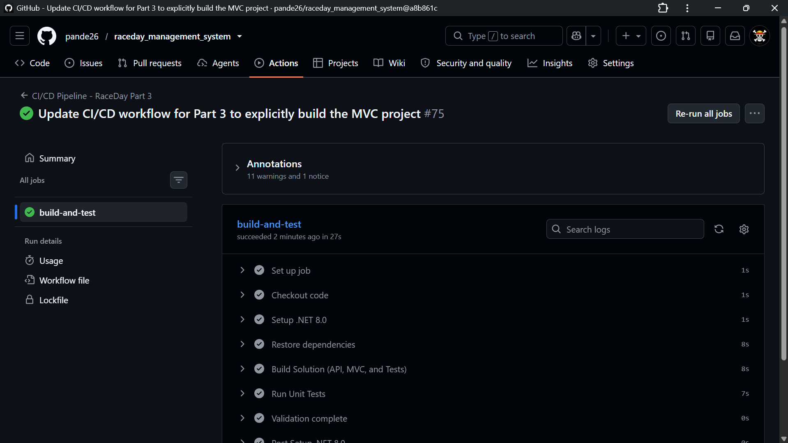

# 🏃 RaceDay - Event Management System

## 📋 Overview

**RaceDay** is a full-stack web-based event management system designed specifically for the South African road running, walking, and cycling community. The platform bridges the gap between Event Organisers and Participants, streamlining the entire event lifecycle from creation to results publishing.

### 🌟 Key Features
- **Event Management**: Create, edit, and manage events with categories
- **Participant Registration**: Browse events and enrol with category selection
- **Results Tracking**: Record and publish race results with finishing positions
- **Role-Based Access**: Separate interfaces for Organisers and Participants
- **Cloud Storage**: Azure Blob Storage integration for event banners and profile pictures (Part 3)
- **Containerized**: Fully Dockerized for easy deployment (Part 3)

---

## 👥 User Roles

### 🎯 Organiser
- Create, edit, and delete events
- Manage event categories (age/distance groups)
- View all event enrolments
- Capture and publish participant results
- Upload event banner images

### 🏃 Participant
- Create account and log in
- Browse upcoming events with filtering
- Enrol in events by selecting a category
- View personal enrolment history
- Track personal race results with finishing positions
- Update profile and upload profile picture

---

# 📘 PART 1 - System Planning and Database

## 📁 Project Structure (Part 1)

```text
raceday_management_system/
├── README.md                                    # This file
├── docs/                                        # Documentation folder
│   ├── API ENDPOINT PLAN.pdf                    # Original API endpoint plan
│   ├── API-ENDPOINT-PLAN.pdf                    # Final API endpoint plan
│   ├── ERD.png                                  # Entity Relationship Diagram
│   ├── raceday_db.sql                           # SQL database script with seed data
│   ├── ci-cd-green-build.png                    # Part 2 & 3 CI/CD green build screenshot
│   └── test-results.png                         # Part 2 unit test results screenshot
└── .github/
    └── workflows/
        └── ci-cd.yml                            # GitHub Actions CI/CD workflow
```

## 🗄️ Database Schema

### Entities (6 Tables)
1. **Users** - Authentication and user information
2. **Events** - Event/race management
3. **Categories** - Age/distance categories per event
4. **Enrolments** - Participant registrations
5. **Results** - Race results and finishing positions
6. **Event_Images** - Gallery images for events

### SQL Table Structures
Below is an overview of the database schema implemented via ADO.NET.

```sql
CREATE TABLE Users (
    user_id INT PRIMARY KEY IDENTITY(1,1),
    email VARCHAR(255) UNIQUE NOT NULL,
    password_hash VARCHAR(255) NOT NULL,
    firstname VARCHAR(100) NOT NULL,
    surname VARCHAR(100) NOT NULL,
    role VARCHAR(20) NOT NULL CHECK (role IN ('Organiser', 'Participant')),
    date_of_birth DATE,
    phone_number VARCHAR(20),
    profile_picture_url VARCHAR(500),
    is_active BIT DEFAULT 1,
    created_at DATETIME DEFAULT GETDATE(),
    updated_at DATETIME
);

CREATE TABLE Events (
    event_id INT PRIMARY KEY IDENTITY(1,1),
    organiser_id INT FOREIGN KEY REFERENCES Users(user_id),
    event_name VARCHAR(150) NOT NULL,
    event_description TEXT,
    event_date DATETIME NOT NULL,
    location VARCHAR(255) NOT NULL,
    distance DECIMAL(5,2) NOT NULL,
    event_type VARCHAR(20) NOT NULL CHECK (event_type IN ('Run', 'Walk', 'Cycle')),
    max_participants INT,
    entry_fee DECIMAL(10,2),
    banner_image_url VARCHAR(500),
    event_status VARCHAR(20) DEFAULT 'Upcoming',
    created_at DATETIME DEFAULT GETDATE()
);

CREATE TABLE Categories (
    category_id INT PRIMARY KEY IDENTITY(1,1),
    event_id INT FOREIGN KEY REFERENCES Events(event_id),
    category_name VARCHAR(100) NOT NULL,
    cat_description VARCHAR(255),
    min_age INT,
    max_age INT,
    min_distance DECIMAL(5,2),
    max_distance DECIMAL(5,2)
);

CREATE TABLE Enrolments (
    enrolment_id INT PRIMARY KEY IDENTITY(1,1),
    event_id INT FOREIGN KEY REFERENCES Events(event_id),
    participant_id INT FOREIGN KEY REFERENCES Users(user_id),
    category_id INT FOREIGN KEY REFERENCES Categories(category_id),
    enrolment_date DATETIME DEFAULT GETDATE(),
    enr_status VARCHAR(20) DEFAULT 'Pending',
    payment_status VARCHAR(20) DEFAULT 'Pending'
);

CREATE TABLE Results (
    result_id INT PRIMARY KEY IDENTITY(1,1),
    enrolment_id INT FOREIGN KEY REFERENCES Enrolments(enrolment_id),
    event_id INT FOREIGN KEY REFERENCES Events(event_id),
    finish_time TIME,
    overall_position INT,
    total_finishers INT,
    category_position INT,
    created_at DATETIME DEFAULT GETDATE()
);

CREATE TABLE Event_Images (
    image_id INT PRIMARY KEY IDENTITY(1,1),
    event_id INT FOREIGN KEY REFERENCES Events(event_id),
    image_url VARCHAR(500) NOT NULL,
    uploaded_at DATETIME DEFAULT GETDATE()
);
```

### ERD Highlights
- ✅ 6 entities with clear relationships
- ✅ Primary and Foreign keys identified
- ✅ Cardinality indicated for all relationships
- ✅ CHECK constraints for data validation
- ✅ Soft delete support (is_active, event_status)
- ✅ Audit fields (created_at, updated_at)

## 🔌 API Endpoint Plan

### Endpoint Summary (38 Total)

| Category | GET | POST | PUT | DELETE | Total |
|----------|-----|------|-----|--------|-------|
| Authentication | 1 | 2 | 0 | 1 | 4 |
| User Profile | 2 | 1 | 1 | 0 | 4 |
| Events | 4 | 2 | 1 | 1 | 8 |
| Categories | 2 | 1 | 1 | 1 | 5 |
| Enrolments | 3 | 1 | 3 | 0 | 7 |
| Results | 4 | 1 | 2 | 1 | 8 |
| Dashboard | 2 | 0 | 0 | 0 | 2 |
| **TOTAL** | **18** | **8** | **8** | **4** | **38** |

### Key Endpoints
- **Authentication**: `/api/authenticator/register`, `/api/authenticator/login`, `/api/authenticator/logout`
- **Events**: `/api/events` (CRUD), `/api/events/{id}/banner` (upload)
- **Categories**: `/api/categories/{id}` (CRUD)
- **Enrolments**: `/api/enrolments/{eventId}`, `/api/enrolments/me`
- **Results**: `/api/results/{eventId}`, `/api/results/me`, `/api/results/{id}/publish`

## 📊 Database Setup Instructions

### Prerequisites
- SQL Server (2019 or later)
- SQL Server Management Studio (SSMS)

### Steps to Create Database

1. **Open SQL Server Management Studio (SSMS)**
2. **Run the SQL Script**
   - Open `docs/raceday_db.sql` in SSMS
   - Click **Execute** (F5) to run the script
3. **Verify Database Creation**

```sql
USE raceday_db;
SELECT * FROM users;
SELECT * FROM events;
SELECT * FROM enrolments;
```

4. **Sample Data Included**
   - 2 Organisers (Thabo Mokoena, Sarah Van Der Merwe)
   - 8 Participants with South African names
   - 4 Events (Comrades, Cycle Tour, Soweto, Two Oceans)
   - Categories for each event
   - Enrolments with various statuses
   - Results with finish times and positions

### Seed Data Statistics

| Entity | Count | Description |
|--------|-------|-------------|
| Organisers | 2 | Event creators |
| Participants | 8 | Registered users |
| Events | 4 | Upcoming events |
| Categories | 24 | Categories per event |
| Enrolments | 24 | Participant registrations |
| Results | 11 | Race results |
| Event Images | 8 | Gallery images |

## 🎥 Part 1 Video Presentation

**YouTube Link:** https://youtu.be/krFDeZUgb2M

**Video Content:**
- 📊 ERD Walkthrough
- 📝 API Endpoint Plan
- 🗄️ SQL Script Demonstration in SSMS
- ✅ Validation of all required components

## 📚 Part 1 Deliverables Checklist

| Deliverable | Status | Location |
|-------------|--------|----------|
| Entity Relationship Diagram | ✅ | `/docs/ERD.png` |
| API Endpoint Plan | ✅ | `/docs/API-ENDPOINT-PLAN.pdf` |
| SQL Database Script | ✅ | `/docs/raceday_db.sql` |
| README.md | ✅ | `/README.md` |
| CI/CD Workflow | ✅ | `/.github/workflows/ci-cd.yml` |
| Green Build Screenshot | ✅ | Included in README |
| Video Presentation | ✅ | https://youtu.be/krFDeZUgb2M |

---

# 🚀 PART 2 - RESTful API Development

## 📋 Overview

The RaceDay API is built with **ASP.NET Core 8.0** and uses **ADO.NET** for direct database access. The API implements **session-based authentication**, **role-based access control** (Organiser vs Participant), and exposes **39 RESTful endpoints** across 7 controllers.

### Key Features
- **Session-Based Authentication**: Server-side sessions with extended timeout
- **BCrypt Password Hashing**: Secure password storage using BCrypt.Net-Next
- **Role-Based Access Control**: Enforced at the controller level
- **Ownership Validation**: Organisers can only modify their own resources
- **Swagger Documentation**: Full XML documentation with response codes
- **Unit Tests**: 18 tests passing locally and in CI/CD

---

## 🛠️ Part 2 Technology Stack

| Layer | Technology |
|-------|------------|
| Framework | ASP.NET Core 8.0 Web API |
| Data Access | ADO.NET (`System.Data.SqlClient`) |
| Authentication | Session-based with BCrypt.Net-Next |
| API Docs | Swashbuckle.AspNetCore (Swagger) |
| Testing | xUnit + Moq |
| CI/CD | GitHub Actions |

---

## 📁 Part 2 Project Structure

```text
raceday_management_system/
├── Controllers/                          # 7 API controllers
│   ├── authenticator.cs                  # Register, login, logout, current-user
│   ├── users.cs                          # Profile viewing/updating
│   ├── events.cs                         # Event CRUD + nested resources
│   ├── categories.cs                     # Category CRUD
│   ├── enrolments.cs                     # Enrolment management
│   ├── results.cs                        # Result recording and leaderboard
│   └── dashboard.cs                      # Organiser & Participant dashboards
├── Database/                             # ADO.NET data helpers
│   ├── Interfaces/                       # 7 interfaces (for testing with Moq)
│   ├── auth_connection.cs                # Auth DB operations
│   ├── users_connection.cs               # User DB operations
│   ├── events_connection.cs              # Event DB operations
│   ├── categories_connection.cs          # Category DB operations
│   ├── enrolments_connection.cs          # Enrolment DB operations
│   ├── results_connection.cs             # Result DB operations
│   └── dashboard_connection.cs           # Dashboard DB operations
├── Models/                               # 6 entity models
├── Services/
│   ├── password_hasher.cs                # BCrypt password hashing
│   └── blob_storage_service.cs           # Azure Blob Storage integration
├── raceday_management_system.Tests/      # Unit test project (xUnit + Moq)
└── Program.cs                            # DI registration and pipeline config
```

---

## 🔌 Part 2 API Endpoints (39 Total)

*(See the full endpoint plan in `docs/API-ENDPOINT-PLAN.pdf`)*

### Authentication (`/api/authenticator`)
- `POST /register` (Public)
- `POST /login` (Public)
- `POST /logout` (Logged in)
- `GET /current-user` (Logged in)

### Events (`/api/events`)
- `GET /` (Any logged in)
- `GET /upcoming` (Any logged in)
- `GET /organiser` (Organiser)
- `POST /` (Organiser)
- `PUT /{eventId}` (Organiser owner)
- `DELETE /{eventId}` (Organiser owner)
- `POST /{eventId}/banner` (Organiser owner)

*(Additional endpoints for Users, Categories, Enrolments, Results, and Dashboards are fully implemented as per the Part 1 plan).*

---

## 🧪 Unit Tests (18 Total)

All tests pass locally and through the GitHub Actions CI/CD workflow.

- **xUnit**: Test framework
- **Moq**: Mocking library for interfaces
- **FakeSession**: Custom `ISession` implementation to simulate user login
- **SessionHelper**: Builds `HttpContext` with preset session values

**Local test run:** `Test summary: total: 18, failed: 0, succeeded: 18, skipped: 0`

---

## 🔧 Part 2 CI/CD Pipeline

### GitHub Actions Workflow

Every push to `main` triggers a workflow that:
1. Restores NuGet packages
2. Builds the solution in Release mode
3. Runs all 18 unit tests
4. Reports green build status

### Green Build Screenshot



---

## 🎥 Part 2 Video Presentation

**YouTube Link:** https://youtu.be/qJepWK_j-eY

---

# 🎨 PART 3 - MVC Web Application & Deployment

## 📋 Overview

Part 3 extends the RESTful API by introducing a full **ASP.NET Core MVC** frontend. This provides a visually engaging, role-based user interface for both Organisers and Participants. It also introduces **Azure Blob Storage** for cloud image hosting and **Docker** for containerization.

### Key Features
- **MVC Frontend**: Responsive UI using Bootstrap and custom CSS.
- **Session Management**: The MVC app securely stores the API session cookie to keep users logged in across requests.
- **Azure Blob Storage**: Event banners and user profile pictures are uploaded directly to the cloud.
- **Graceful Error Handling**: Global exception handling redirects expired sessions back to the login page.
- **Dockerized**: The MVC application is fully containerized and can communicate with the local API.

---

## 📁 Part 3 Project Structure

```text
raceday_management_system.MVC/
├── Controllers/
│   ├── auth_controller.cs                # Handles Login, Register, Logout
│   ├── events_controller.cs              # Participant Event Browsing & Details
│   ├── HomeController.cs                 # Home page with upcoming events
│   ├── organiser_controller.cs           # Organiser Dashboard & CRUD operations
│   ├── participant_controller.cs         # Participant My Events & Results
│   └── profile_controller.cs             # Shared profile management (both roles)
├── Models/                               # View Models mapping to API JSON
│   ├── category_view_model.cs
│   ├── create_event_view_model.cs
│   ├── dashboard_view_model.cs
│   ├── edit_event_view_model.cs
│   ├── enrolment_status_view_model.cs
│   ├── enrolment_view_model.cs
│   ├── event_card_view_model.cs
│   ├── event_details_view_model.cs
│   ├── login_view_model.cs
│   ├── my_event_view_model.cs
│   ├── my_result_view_model.cs
│   ├── profile_view_model.cs
│   ├── record_result_view_model.cs
│   └── register_view_model.cs
├── Services/
│   └── api_service.cs                    # HttpClient wrapper for API communication
├── Views/
│   ├── Auth/                             # Login.cshtml, Register.cshtml
│   ├── Events/                           # Details.cshtml, AllEvents.cshtml
│   ├── Home/                             # Index.cshtml (Hero banner & event grid)
│   ├── Organiser/                        # Dashboard, CreateEvent, EditEvent, 
│   │                                     # ManageCategories, EventEnrolments, 
│   │                                     # RecordResult, ViewResults
│   ├── Participant/                      # MyEvents.cshtml, MyResults.cshtml
│   ├── Profile/                          # Index.cshtml (shared profile view)
│   └── Shared/                           # _Layout.cshtml (Navbar, Session logic)
├── wwwroot/
│   ├── css/site.css                      # Custom RaceDay branding & Flexbox footer
│   └── images/                           # logo.png, default-profile.png, hero-bg.jpeg, icons/
├── appsettings.json                      # API Base URL Configuration
├── Dockerfile                            # Multi-stage build for containerization
└── Program.cs                            # DI registration, Sessions, HttpClient setup

---

## 🚀 Setup and Run Instructions

### Prerequisites
- Visual Studio 2022 (with ASP.NET and web development workload)
- SQL Server Management Studio (SSMS)
- Docker Desktop (for Part 3)

### 1. Database Setup
1. Open SSMS and run the `docs/raceday_db.sql` script to create the database and seed data.
2. Verify the database was created successfully.

### 2. API Setup
1. Open the solution in Visual Studio.
2. Ensure `raceday_management_system` (the API) is set as the Startup Project.
3. Ensure you have your Azure Storage connection string set in `appsettings.Development.json`.
4. Press **F5** to run the API. Swagger will open in your browser.

### 3. MVC Application Setup
1. Right-click the solution, go to **Properties** -> **Configure Startup Projects**.
2. Select **Multiple startup projects**.
3. Set `raceday_management_system` and `raceday_management_system.MVC` to **Start**.
4. Press **F5**. Both projects will launch, and your browser will open the MVC frontend.

---

## ☁️ Azure Blob Storage Integration

The system integrates with Microsoft Azure for scalable image hosting.
- **Event Banners**: Organisers upload banners when creating/editing events.
- **Profile Pictures**: Participants can upload a profile picture.
- **Fallback Images**: A default avatar is displayed if a user hasn't uploaded a picture.

*Note: To run this locally, you must provide your own Azure Storage connection string in `appsettings.Development.json` within the API project.*

---

## 🐳 Docker Deployment (MVC Application)

The MVC frontend is fully containerised. Because the frontend needs to communicate with the backend API running on your local machine, we use the `host.docker.internal` DNS name to allow the container to connect to the host machine.

**Prerequisites:**
1. Ensure **Docker Desktop** is running.
2. Ensure the backend API (`raceday_management_system`) is running locally on HTTP port `5138` (use the `http` profile in Visual Studio).

**1. Build the Docker Image**
From the root of the solution, run the following command to build the image:

```bash
docker build -t raceday-mvc -f raceday_management_system.MVC/Dockerfile .
```

**2. Run the Docker Container**
Run the container in detached mode, mapping port 8080, and passing the API Base URL as an environment variable:

```bash
docker run -d -p 8080:8080 --name raceday-mvc-container -e ApiSettings__BaseUrl="http://host.docker.internal:5138/api/" raceday-mvc
```

**3. Access the Application**
Open your browser and navigate to:

```text
http://localhost:8080
```

**4. Stop and Remove the Container (When finished)**

```bash
docker stop raceday-mvc-container
docker rm raceday-mvc-container
```

---

## 📚 Part 3 Deliverables Checklist

| Deliverable | Status | Location |
|-------------|--------|----------|
| ASP.NET Core MVC App | ✅ | `/raceday_management_system.MVC/` |
| API Integration (HttpClient) | ✅ | `api_service.cs` |
| Login & Registration UI | ✅ | `Views/Auth/` |
| Organiser Dashboard & CRUD | ✅ | `Views/Organiser/` |
| Participant Interface | ✅ | `Views/Participant/` |
| Azure Blob Storage Upload | ✅ | `blob_storage_service.cs` |
| Docker Containerization | ✅ | `Dockerfile` |

---

## 🎥 Part 3 Video Presentation

**YouTube Link:** https://youtu.be/5k9dgMO1HKI

---

## 📊 Commit Statistics

| Part | Minimum Required | Actual Commits | Status |
|------|------------------|----------------|--------|
| Part 1 | 20 | 25+ | ✅ |
| Part 2 | 20 | 20+ | ✅ |
| Part 3 | 20 | 20+ | ✅ |

---

## 🛠️ Technology Stack (Full Project)

| Layer | Technology |
|-------|------------|
| Frontend | ASP.NET Core MVC, Bootstrap, Custom CSS |
| Backend API | ASP.NET Core Web API (C#) |
| Data Access | ADO.NET (`System.Data.SqlClient`) |
| Database | SQL Server (SSMS) |
| Authentication | Session-based + BCrypt |
| Cloud Storage | Azure Blob Storage |
| Testing | xUnit + Moq |
| CI/CD | GitHub Actions |
| Containerization | Docker |

---

## 📝 Version History

| Version | Date | Changes |
|---------|------|---------|
| 1.0 | 2026-09-03 | Initial Part 1 submission |
| 2.0 | 2026-10-13 | Part 2 - RESTful API with authentication, 39 endpoints, and 18 unit tests |
| 3.0 | 2026-11-05 | Part 3 - MVC Web App, Azure Blob Storage integration, and Docker containerization |

---

## 🔗 GitHub Repository

**Repository Link:** https://github.com/pande-m19/raceday_management_system.git

---

## 👨‍💻 Author

**Pandelani**
- GitHub: [@pande-m19](https://github.com/pande-m19)

---

## 📄 License

This project is created for academic purposes as part of the Portfolio of Evidence (POE) for the Software Development course.

---

## 🙏 Acknowledgements

- South African road events community (Comrades Marathon, Cape Town Cycle Tour, Soweto Marathon, Two Oceans Marathon)
- Lecturers and mentors providing guidance throughout the project

---

**✅ Part 1 - System Planning and Database - COMPLETE**

**✅ Part 2 - RESTful API Development - COMPLETE**

**✅ Part 3 - MVC Web Application & Deployment - COMPLETE**